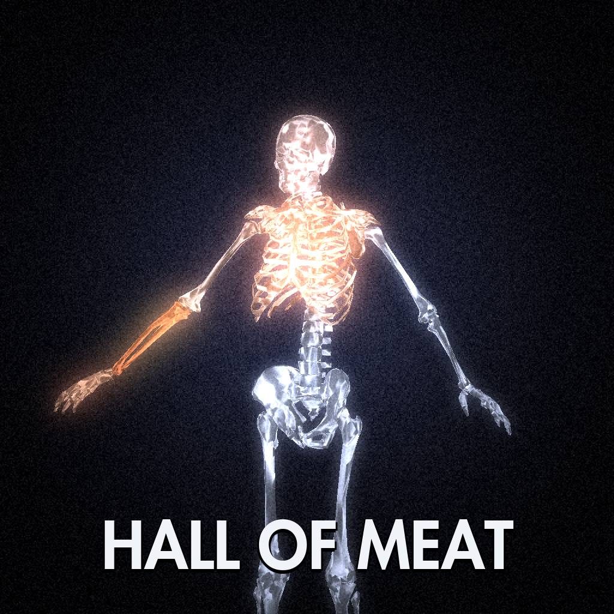

# Hall of Meat for Skate 4

**The nostalgic one.** Skate 3's Hall of Meat, brought to Skate 4 (skate.) through
[ReSkate](https://github.com/Dingo-Shenanigans/ReSkate) with Skate 3's own data: its bone meshes, damage
table, score graphs, Thrasher score panel, bone-crunch and slow-motion sounds, colour grade and film grain.
Crash, and the picture closes in to a dark, grainy blue-grey spotlight while your skeleton shows through
the body, every hurt bone glowing orange and every break burning red as it happens.

## Why this one

ReSkate 2.0 ships a Hall of Meat of its own: a fresh take built from skate.'s parts. This mod is the
other road: Skate 3's Hall of Meat itself, rebuilt from Skate 3's files and tuned frame by frame against
Skate 3 footage, so it looks, sounds and scores the way you remember.

| | Skate 3 Hall of Meat (this mod) | ReSkate's built-in Hall of Meat |
|---|---|---|
| Skeleton | Skate 3's own X-ray bone meshes and bone texture | skate.'s Dem Bones costume mesh |
| Hurt bones | Skate 3's orange glow, red-orange throbbing breaks | yellow bruises, red breaks |
| Score panel | Skate 3's Thrasher "Hall of Meat" panel and rows | ReSkate's Meat card |
| Scoring | Skate 3's 25-part damage table and score graphs for air, drop, bail time, speed and rotation | ReSkate's own Meat formula |
| Sounds | Skate 3's bone crunches and slow-motion sound | none |
| Look | Skate 3's colour matrix, blue-grey grade, spotlight and film grain | red screen edge pulse |
| Slow motion on a break | yes (single player), as Skate 3's `IsBrokenBoneSlowMo` | yes (single player) |
| Car hits | Skate 3's car bonus (2,000 a car) with its chip | count half again |
| Each map's best | yes | yes |
| Multiplayer | yes (built on ReSkate v2.0.1) | yes |

Both can be installed: this one steps aside whenever ReSkate's is switched on, so only one shows at a time.

## Download

- **[Latest release](https://github.com/layton-brewer/Hall-Of-Meat-for-Skate-4/releases/latest)** (also on the
  [ReSkate fork](https://github.com/layton-brewer/ReSkate-Hall-Of-Meat/releases/latest)):
  - `ReSkate-HallOfMeat-<version>.zip`: ReSkateLauncher.exe and ReSkate.dll (official ReSkate v2.0.1 plus
    Skate 3 Hall of Meat, so multiplayer works with everyone on v2.0.1).
  - `Hall_of_Meat-<version>.zip`: the asset pack (Thunderstore format).
- Leave ReSkate's own Hall of Meat off (Custom Stuff > Player > Hall of Meat) to see this one.

## Install

1. Close the game.
2. Copy `ReSkateLauncher.exe` and `ReSkate.dll` beside `Skate.exe`.
3. Drag the asset pack zip onto the launcher's MODS page, or extract it into `Mods\Hall_of_Meat\`.
4. Start the game with that launcher (it does not update itself, so it keeps Hall of Meat).

Turn Hall of Meat off by turning the asset pack off in the MODS tab (Insert menu). Console: `hom status`.

## What is in it

- **X-ray** drawn with Skate 3's own 19 bone meshes and bone texture, placed on the ragdoll's physics
  bodies every frame, from the crash until you get up.
- **Skate 3's damage model**, taken from its attribute database: 25 body parts, up to six levels each
  (bruised to broken) with Skate 3's points and impact thresholds, and hits passed to linked parts.
- **Skate 3's score graphs** for bail time, drop, air, speed and rotation (they reproduce the original
  HUD's readings), and the HUD rules from its `homscoring` script.
- **Skate 3's bone-crunch sounds**, decoded from its HOM banks.
- **Orange bone glow**: hurt bones heat from bone white to Skate 3's orange, broken ones burn red-orange.
- **Broken-bone slow motion** (single player only) and red screen edges on a break, as Skate 3's `IsBrokenBoneSlowMo`.
- **Skate 3's car bonus** (its `VehicleData`: 2,000 a car) with its own chip, and Skate 3's slow-motion sound.
- **Each map's best bail**, saved with the profile (NEW BEST / BEST under the score).
- **The HoM look**, measured from Skate 3's footage: cool blue-grey, colour pulled out, black corners,
  coarse film grain.
- **Crash detection** tuned frame by frame on 20 test recordings: wipeouts, slams, being knocked off,
  crash landings onto ramps and on-foot falls start it at once; glides, dives, hippy jumps, plants and
  stepping off do not.

## This repository

| Folder | Contents |
|---|---|
| `mod/` | The Thunderstore asset pack: manifest, README, changelog, icon, and `HallOfMeat/` (Skate 3's art, X-ray meshes, sounds, fonts). |
| `source/` | A snapshot of `Extension/Skate3HallOfMeat/` from the fork (the live code is in [layton-brewer/ReSkate-Hall-Of-Meat](https://github.com/layton-brewer/ReSkate-Hall-Of-Meat/tree/skate3-hom-2.0.1)). |
| `tests/` | `core_test.cpp`: offline checks of the crash detection and scoring, many rebuilt from test-video logs. |
| `tools/` | The Skate 3 research tools: XEX decryption, EA APT script disassembly, attribute vault reader and name hashing, EA-XMA sound decoding, texture and mesh export. |
| `docs/` | `HOM-FINDINGS.md`: what Skate 3's files say about Hall of Meat. |

Hall of Meat, its art, meshes and sounds are from Skate 3 by EA Black Box; Thrasher is a trademark of
High Speed Productions. Fan project, not affiliated with or endorsed by EA.
